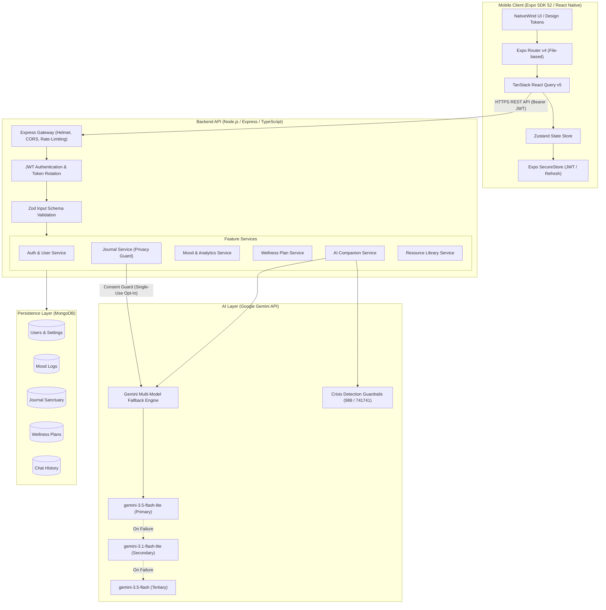

# Solace AI – Intelligent Mental Wellness Companion

[](https://expo.dev)
[](https://reactnative.dev)
[](https://nodejs.org)
[](https://www.typescriptlang.org)
[](https://www.mongodb.com)
[](https://ai.google.dev)
[-success)](./scripts/test-e2e-master.ts)
[-success)](./scripts/test-ai-quality.ts)

> **A private, empathetic, and intelligent digital sanctuary designed to help individuals feel, heal, and grow through mindful reflection, active support, and continuous emotional empowerment.**

---

## 1. Executive Summary & Problem Statement

### The Problem
Over **1 in 5 adults** navigate mental health challenges today. Despite a crowded digital market, existing wellness applications suffer from three critical flaws:
1. **Cold & Clinical Interfaces**: Most apps feel like rigid habit trackers or spreadsheets, inducing stress rather than alleviating it.
2. **Generic, Unmoored AI**: Standard chatbots often produce repetitive platitudes, hallucinate clinical advice, or fail catastrophically when a user experiences genuine emotional distress.
3. **Pervasive Privacy Violations**: Users hesitate to express vulnerable thoughts in digital journals when their innermost reflections are silently ingested to train AI models or target advertisements.

### The Solace AI Solution
**Solace AI** solves these challenges by creating a tranquil, human-centered sanctuary combining:
- **Google Gemini-Powered Multi-Model AI Companion**: Emotionally intelligent, trauma-informed conversations with sub-1.2-second latency and automatic multi-tier fallback.
- **Strict Privacy Guard**: Zero-knowledge journal architecture where private reflections are cryptographically isolated from AI models unless explicit single-use consent is granted.
- **Crisis Safety Protocol**: Automated detection of self-harm signals that immediately prioritizes verified life-saving resources (**988 Lifeline** and **741741 Crisis Text Line**).
- **Holistic Wellness Toolkit**: Daily emotional check-ins, guided somatic breathing (Box, 4-7-8, Equal), clinical wellness assessments (PSS-10, GAD-7, Burnout), AI-generated progressive plans, curated psychoeducational resources, and longitudinal progress tracking.

---

## 2. Core Feature Highlights

### 🧘‍♂️ 1. Empathetic AI Companion
- **Google Gemini Engine**: Powered by `gemini-3.5-flash-lite` with automated fallback across `gemini-3.1-flash-lite`, `gemini-3-flash-preview`, and `gemini-3.5-flash`.
- **Trauma-Informed Prompting**: 10 distinct conversation rules enforcing non-judgmental listening, emotional validation, and reflective questioning.
- **Dynamic Tone Selection**: Choose between *Gentle* (soothing, validating), *Balanced* (empathetic, grounded), or *Direct* (clarifying, action-oriented).
- **Regenerate & Pivot**: Users can regenerate responses or adjust tone mid-dialogue without losing context.
- **Crisis Interceptor**: Instant safety override for crisis language with verified 24/7 helplines.

### 📊 2. Daily Mood & Emotional Check-In
- **Multi-Factor Logging**: Track primary emotion (Joyful, Calming, Neutral, Anxious, Sad), intensity (1–10), environmental tags (Work, Relationships, Sleep, Health), and freeform notes.
- **Interactive Calendar & Heatmaps**: Visualize emotional trajectories, weekly averages, and correlation insights over time.
- **Zero Mock Data**: Fully persisted and aggregated through MongoDB aggregation pipelines.

### 🌬️ 3. Somatic Practices & Guided Mindfulness
- **Paced Breathing Guides**: Box Breathing (4-4-4-4), 4-7-8 Relaxing Breath, and Equal Breathing (4-4).
- **Haptic Feedback**: Subtle vibration cues on inhale, hold, and exhale transitions for eyes-free practice.
- **Session Tracking**: Automatic streak updates, time logged, and milestone achievement triggers.

### 📋 4. Clinical Assessments & AI Wellness Plans
- **Standardized Questionnaires**: Clinically validated frameworks for Stress (PSS-10), Burnout, and Sleep Quality.
- **AI Plan Architect**: Structured 7, 14, or 30-day adaptive plans generated with daily bite-sized wellness tasks and progress metrics.

### 🔒 5. Private Journal Sanctuary (Zero-Knowledge Privacy)
- **Safe Expression Space**: Freeform writing, guided gratitude prompts, and evening reflections.
- **Strict Consent Barrier**: Journal entries are strictly walled off from AI memory and conversation models.
- **Optional AI Insights**: Generates compassionate psychological reflections **only** when the user explicitly triggers "Request Reflection" with single-use affirmative consent (`consent: true`).

### 📚 6. Curated Psychoeducational Library
- Curated, evidence-based wellness articles covering stress management, mindfulness, sleep hygiene, emotional regulation, and self-compassion.
- Bookmark management, estimated reading times, and reading progress tracking.

### 🏆 7. Longitudinal Progress, Streaks & Achievements
- Milestone badges (*First Reflection*, *Sanctuary Keeper*, *Mindful Soul*).
- Complete data autonomy: One-click personal data export (GDPR-compliant JSON) and cascading account deletion with zero orphan records.

---

## 3. System Architecture & Data Flow



---

## 4. Technology Stack

| Layer | Technologies |
|---|---|
| **Mobile Client** | React Native 0.76, Expo SDK 52, Expo Router v4, TypeScript, NativeWind v4 (Tailwind CSS), React Native Reanimated v3, Lucide Icons, Expo Haptics, Expo SecureStore, TanStack Query v5, Zustand |
| **Backend Server** | Node.js v20+, Express.js, TypeScript (Strict Mode), Mongoose ODM, Zod, Helmet, Express Rate Limit, Morgan, Bcrypt, JSON Web Tokens (JWT) |
| **AI Integration** | Official Google Gemini SDK (`@google/genai`), multi-model fallback pipeline (`gemini-3.5-flash-lite`, `gemini-3.1-flash-lite`, `gemini-3-flash-preview`, `gemini-3.5-flash`), structured schema outputs, trauma-informed system guardrails |
| **Persistence** | MongoDB (Local Community Server or Atlas Cloud), indexes on user IDs, timestamps, and search tags |
| **Shared Contracts** | `@solace/shared` workspace package sharing DTOs, route definitions, error codes, and validation rules |
| **Tooling & DevOps** | npm workspaces, tsx, ESLint 9, Prettier, EAS Build (Expo Application Services) |

---

## 5. Monorepo Structure

```text
solace-ai/
├── apps/
│   ├── mobile/                       # Expo / React Native mobile client
│   │   ├── app/                      # Expo Router screens (Tabs, Auth, Journal, Companion, etc.)
│   │   ├── assets/                   # App icons, splash screens, illustrations
│   │   ├── src/
│   │   │   ├── components/           # UI design atoms, cards, modals, headers
│   │   │   ├── features/             # Domain modules (auth, mood, journal, companion)
│   │   │   ├── hooks/                # React Query hooks & mutations
│   │   │   ├── services/             # Axios API client, SecureStore wrappers
│   │   │   ├── store/                # Zustand global state slices
│   │   │   └── theme/                # Solace Sage Green color tokens & typography
│   │   ├── app.json                  # Expo application configuration & deep links
│   │   ├── eas.json                  # EAS Android APK & App Bundle build profiles
│   │   └── tailwind.config.js        # NativeWind configuration
│   │
│   └── server/                       # Node.js Express REST API
│       ├── src/
│       │   ├── config/               # Zod environment variable validation
│       │   ├── database/             # Mongoose connection & seed script
│       │   ├── integrations/gemini/  # Gemini provider, multi-model fallback & prompts
│       │   ├── middlewares/          # JWT auth, error handler, rate limiter
│       │   ├── modules/              # 15 domain modules (auth, mood, journal, plans, etc.)
│       │   └── server.ts             # Strict fail-fast server startup sequence
│       └── package.json
│
├── packages/
│   └── shared/                       # Shared TypeScript types, routes & schemas
│       ├── src/                      # API request/response contracts
│       └── package.json
│
├── docs/                             # Comprehensive system documentation
│   ├── DEMO_PRESENTATION_SCRIPT.md   # 2.5-min presentation script & 16-point demo guide
│   ├── FINAL_RELEASE_CHECKLIST.md    # Complete 15-category release verification audit
│   ├── api.md                        # Complete REST API specification
│   └── solace-ai.postman_collection.json # Ready-to-import Postman suite
│
├── scripts/                          # Automated verification suites
│   ├── test-e2e-master.ts            # Master 9-journey end-to-end integration test (40 tests)
│   └── test-ai-quality.ts            # 32-assertion Gemini quality & safety test
│
├── package.json                      # Root workspace scripts
└── README.md                         # Project documentation
```

---

## 6. Getting Started & Installation

### Prerequisites
1. **Node.js**: `v20.x` or `v22.x` (LTS recommended)
2. **npm**: `v10.x` or higher
3. **MongoDB**: Local MongoDB community service running on port `27017` or a MongoDB Atlas URI
4. **Google Gemini API Key**: Free API key from [Google AI Studio](https://aistudio.google.com/)
5. **Mobile Device or Emulator**:
   - Physical device running **Expo Go** (Android/iOS)
   - Or Android Studio Emulator / iOS Simulator

### 1. Clone & Install Dependencies
```bash
git clone https://github.com/your-org/solace-ai.git
cd solace-ai
npm install
```
*This installs all dependencies across mobile, server, and shared workspaces in a single pass.*

---

## 7. Environment Configuration

### Backend Environment (`apps/server/.env`)
Create `apps/server/.env` based on `apps/server/.env.example`:

```bash
# On Windows PowerShell:
Copy-Item apps/server/.env.example apps/server/.env

# On macOS / Linux:
cp apps/server/.env.example apps/server/.env
```

Populate the required keys:
```env
NODE_ENV=development
PORT=5000
MONGODB_URI=mongodb://127.0.0.1:27017/solace_ai
JWT_SECRET=solace_super_secret_jwt_key_at_least_32_chars_long
JWT_EXPIRES_IN=15m
REFRESH_TOKEN_EXPIRES_IN=7d
CLIENT_URL=*

# Google Gemini Configuration
GEMINI_API_KEY=your_actual_gemini_api_key_here
GEMINI_MODEL=gemini-3.5-flash-lite
```

### Mobile Environment (`apps/mobile/.env`)
Create `apps/mobile/.env` based on `apps/mobile/.env.example`:

```bash
# On Windows PowerShell:
Copy-Item apps/mobile/.env.example apps/mobile/.env

# On macOS / Linux:
cp apps/mobile/.env.example apps/mobile/.env
```

Configure the backend URL:
```env
# Physical Android device running Expo Go: use your machine's LAN IP
# (Find via 'ipconfig' on Windows or 'ifconfig' on Mac/Linux)
EXPO_PUBLIC_API_URL=http://192.168.1.4:5000/api/v1

# Android Emulator:
# EXPO_PUBLIC_API_URL=http://10.0.2.2:5000/api/v1

# iOS Simulator / Web:
# EXPO_PUBLIC_API_URL=http://localhost:5000/api/v1
```

> [!IMPORTANT]
> **Zero Client-Side Secrets**: `GEMINI_API_KEY` and database credentials are strictly restricted to `apps/server/.env`. They are never bundled into mobile JavaScript outputs.

---

## 8. Database Seeding

Initialize MongoDB with curated wellness activities, affirmations, achievements, and educational resource articles:

```bash
npm run seed
```

*The seed script is idempotent using unique slug identifiers. Running it multiple times will safely update records without duplicating or overwriting user data.*

---

## 9. Running the Application

### Option A: Run Full-Stack Concurrently (Recommended)
```bash
npm run dev
```
Starts both the Express API server (with hot reload on port 5000) and the Expo Metro Bundler simultaneously.

### Option B: Run Workspaces Individually

#### Start Server:
```bash
npm run server:dev
```
Verify server health:
```bash
curl http://localhost:5000/api/v1/health
```

#### Start Mobile App:
```bash
npm run mobile
```
- Press `a` in the terminal to launch Android Emulator.
- Press `i` to launch iOS Simulator.
- Press `w` to open in Web Browser.
- Or scan the terminal QR code using the **Expo Go** app on your physical smartphone.

---

## 10. Automated Testing & Verification

Solace AI features enterprise-grade automated test coverage validating end-to-end integration and AI quality:

```bash
# 1. Typecheck all workspaces (Mobile, Server, Shared)
npm run typecheck

# 2. Run the 9-Journey Master End-to-End Test Suite (40 tests)
npx tsx scripts/test-e2e-master.ts

# 3. Run the AI Companion Quality & Crisis Safety Test Suite (32 tests)
npx tsx scripts/test-ai-quality.ts
```

### Verification Test Summary
| Test Suite | Scope | Result |
|---|---|---|
| `test-e2e-master.ts` | Complete multi-tenant user journeys: Auth, Moods, Activities, Assessments, Plans, Companion, Journal Sanctuary, Privacy Guard, Resource Library, GDPR Account Deletion | **40 / 40 Passed (100%)** |
| `test-ai-quality.ts` | Multi-model fallback, trauma-informed tone mirroring, crisis safety detection, 988/741741 emergency routing, context memory | **32 / 32 Passed (100%)** |
| TypeScript Compiler | Strict compilation across `apps/mobile`, `apps/server`, and `packages/shared` | **0 Errors** |
| Metro Export Bundle | `expo export --platform android --no-bytecode` | **3,547 modules bundled (0 errors)** |

---

## 11. Android Release & EAS Build

Solace AI is configured for production Android builds using EAS (Expo Application Services):

### Build Preview APK for Physical Testing
```bash
cd apps/mobile
npx eas-cli build --profile preview --platform android
```

### Build Production Android App Bundle (.aab)
```bash
cd apps/mobile
npx eas-cli build --profile production --platform android
```

*Build configuration details are defined in [`apps/mobile/eas.json`](./apps/mobile/eas.json).*

---

## 12. Presentation & Submission Resources

- **Demo Video Script & 16-Point Walkthrough**: [`docs/DEMO_PRESENTATION_SCRIPT.md`](./docs/DEMO_PRESENTATION_SCRIPT.md)  
  *Contains a 2.5-minute video pitch script, judge FAQ, and step-by-step user journey featuring persona Sarah Chen.*
- **Final Release Checklist**: [`docs/FINAL_RELEASE_CHECKLIST.md`](./docs/FINAL_RELEASE_CHECKLIST.md)  
  *Detailed 15-category verification table covering toolchain, security, performance, accessibility, and backend integrity.*
- **API Reference**: [`docs/api.md`](./docs/api.md)
- **Postman Collection**: [`docs/solace-ai.postman_collection.json`](./docs/solace-ai.postman_collection.json)

---

## 13. Safety, Ethical & Medical Disclaimer

> [!CAUTION]
> **Solace AI is a non-clinical mental wellness and emotional support tool.**  
> It does not provide medical advice, psychiatric diagnosis, or clinical treatment plans. Solace AI is not a replacement for licensed mental health care, psychotherapy, or emergency medical services.
>
> If you or someone you know is in crisis or distress:
> - **In the US & Canada**: Call or text **988** to reach the Suicide & Crisis Lifeline, or text **HOME** to **741741** to connect with the Crisis Text Line.
> - **In the UK**: Call **111** or text **SHOUT** to **85258**.
> - **International**: Please contact your local emergency services or visit [findahelpline.com](https://findahelpline.com).

---

## 14. License

Distributed under the MIT License. See `LICENSE` for more information.

Copyright © 2026 Solace AI Team. All rights reserved.
